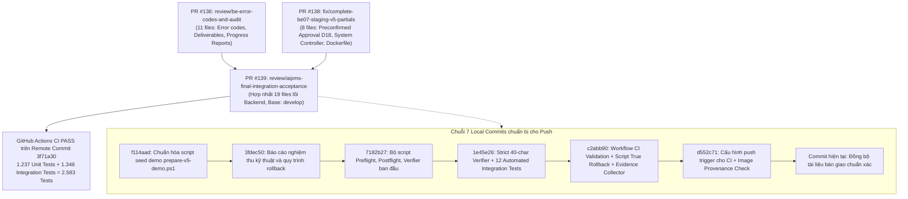

# AI-PMS — BẢN TỔNG QUAN DỰ ÁN VÀ BÀN GIAO KỸ THUẬT TOÀN DIỆN
## Comprehensive Delivery Preview for Project Team (Tin, Khải, Frontend & QA)

> **Dự án**: AI-PMS (Academic Project Management System)
> **Phiên bản**: v5.0 Core Academic Release
> **Nhánh Review**: `review/aipms-final-integration-acceptance`
> **Pull Request**: **PR #139** (Hợp nhất duy nhất từ PR #136 và PR #138, Base: `develop`)
> **Remote PR #139 HEAD**: `3f71a30f1f03027be203025e17b2a6908d0ef84b`
> **Local Baseline HEAD (trước khi cập nhật tài liệu bàn giao)**: `d552c71ed0063d8b3043f6930b69aa139a7e2488` (ahead 6 commits)
> **Số commit local chưa push**: 7 commits (gồm 6 commits kỹ thuật/tooling + 1 commit tài liệu bàn giao)
> **Thời điểm cập nhật**: 30/10/2026 (GMT+7)
> **Người thực hiện**: Lead Engineer & Bạn

---

## 1. TỔNG QUAN ĐIỀU HÀNH (EXECUTIVE SUMMARY)

Toàn bộ công việc kỹ thuật ở tầng Backend của dự án AI-PMS đã được giải quyết dứt điểm và chuẩn bị đầy đủ cho việc chuyển giao:

1. **Hợp nhất mã nguồn vào PR #139**: Đã hợp nhất các thay đổi từ PR #136 và PR #138 vào **DUY NHẤT PR #139** (Base: `develop`), giải quyết toàn bộ xung đột mã nguồn.
2. **Nghiệp vụ Backend 14/14 module v5 (UC-135 đến UC-148)**: Hoàn tất 100% mã nguồn theo đúng Governance Baseline v5 và SRS, bảo vệ các bất biến học vụ nghiêm ngặt (D17 chống xung đột GVHD chấm COLD, D18 không tự kích hoạt đồ án Draft, kiểm soát phòng/giờ bảo vệ, phân quyền AI Assistant liên ngành).
3. **Chất lượng kiểm thử**:
   - **2.583 tests** (1.237 Unit + 1.346 Integration) trên GitHub Actions **PASS 100%** trên remote target commit `3f71a30`.
   - **22 targeted integration tests** cục bộ **PASS 100%** (bao gồm 10 tests cho `SystemEndpointTests` và 12 tests tự động cho `StagingCommitVerifierScriptTests`).
   - Solution `AIPMS.sln` biên dịch ở cấu hình Release: **0 Warnings, 0 Errors**.
4. **Bộ công cụ DevOps & Staging Verification chuyên dụng**:
   - Script PowerShell kiểm tra staging: `scripts/verify-staging-commit.ps1` (kiểm tra chuẩn xác 40 ký tự hex, từ chối fallback `"1.0.0"`, nhận diện Cloudflare 1033).
   - Script Preflight kiểm tra trước khi deploy: `deploy/wsl/preflight-deploy.sh` (hỗ trợ `--dry-run` tuyệt đối an toàn).
   - Script Postflight kiểm tra sau deploy: `deploy/wsl/postflight-verify.sh` (tự động dò cổng động, kiểm tra nhãn image label và endpoint).
   - Script Rollback thực sự: `deploy/wsl/rollback.sh` (phục hồi chuẩn xác bằng Image ID đã lưu, không chạy lệnh restart giả lập).
   - Script thu thập bằng chứng WSL read-only: `deploy/wsl/collect-wsl-evidence.sh` (không để lộ secrets).
5. **Workflow kiểm chứng tự động trên GitHub Runner**:
   - File `.github/workflows/backend-deployment-validation.yml` chạy trên runner `ubuntu-latest` có Docker thật, tự động diễn tập chu trình: Build A → Deploy A → Verify A → Build B → Deploy B → Rollback A → Verify Image ID & API A.
   - Cấu hình trigger `push` trực tiếp trên branch `review/aipms-final-integration-acceptance`. **Trạng thái: PENDING PUSH (sẽ tự động kích hoạt ngay sau khi Bạn push code)**.

---

## 2. HÀNH TRÌNH TỪ PR #136, #138 ĐẾN PR #139



---

## 3. CÁC HẠNG MỤC KỸ THUẬT ĐÃ GIẢI QUYẾT CHI TIẾT

### 3.1. Nghiệp vụ 14 Module Học vụ v5 & Bất biến Domain (Governance Baseline v5)
- **UC-135 (Review Gates)**: 77 tests PASS. Đóng gói đầy đủ evidence và gate assignments.
- **UC-136 (Chat & Attachments)**: REST API và WebSocket SignalR Hub (`/hubs/chat`), kiểm soát thành viên nhóm chặt chẽ, upload file giới hạn 10MB.
- **UC-137 (Appeals & Corrections)**: 30 tests PASS. Đóng/mở đợt nhận đơn (`409 APPEAL_WINDOW_CLOSED`), phân công reviewer (chặn GVHD chính), kiểm soát tương tranh lạc quan qua `concurrencyToken`.
- **UC-138 (Industry Advisory)**: 24 tests PASS. Hồ sơ chuyên gia doanh nghiệp và đánh giá chuyên môn.
- **UC-139 (Weekly Assessments)**: 13 tests PASS. Barem rubric và điểm đánh giá tuần.
- **UC-140 (Peer Evaluation)**: Đánh giá chéo thành viên trong nhóm đồ án.
- **UC-141 (Working Agreement)**: Kích hoạt thỏa thuận làm việc và cam kết thành viên.
- **UC-142 (COLD Reports & Evaluation)**: 21 tests PASS. Bắt buộc có ít nhất 1 báo cáo required mới cho phép tạo checklist; chỉ Lead Department Staff có quyền khóa checklist (thiếu báo cáo trả `409 COLD_REPORT_REQUIRED`); **Bất biến D17** chặn GVHD chính chấm COLD đề tài mình (`409 EVALUATOR_ROLE_CONFLICT`).
- **UC-143 (Defense Committees & Sessions)**: 9 tests PASS. Thành lập Hội đồng, xếp lịch bảo vệ phát hiện và chặn trùng phòng/giờ (409 Conflict); hủy lịch tự động phát sinh audit trail và email queue.
- **UC-144 (Sprints & Tasks)**: Quản lý sprint, task và milestone học vụ.
- **UC-145 (Meeting Collaboration)**: 28 tests PASS. Lịch họp, điểm danh và biên bản cuộc họp.
- **UC-146 (Unified Capabilities)**: Động hóa ma trận phân quyền RBAC (`user_roles`, `role_permissions`).
- **UC-147 (Milestone Templates)**: 21 tests PASS. Kích hoạt và áp dụng mẫu mốc tiến độ theo kỳ học.
- **UC-148 (Academic AI Assistant)**: 32 tests PASS. Hỏi đáp quy chế và tiến độ đồ án, stream NDJSON, trích dẫn citations, rate limit 20 req/phút (429 Too Many Requests), phân tách bảo mật đồ án liên ngành (403 Forbidden), fallback an toàn khi upstream gián đoạn.
- **BE-07 D18 Supervisor Lifecycle**: 78 tests PASS. Khi GVHD chấp thuận đồ án ở trạng thái `DRAFT`, hệ thống **không tự ý chuyển sang `ACTIVE`** mà giữ nguyên `DRAFT` chờ Phòng Đào tạo duyệt chính thức.

### 3.2. Giải mã và Xử lý Vấn đề COMMIT_SHA trên Staging
- **Hiện tượng**: Endpoint staging `https://api-staging.khaidz.com/api/v1/system` trả về `commitSha: "1.0.0"`.
- **Nguyên nhân kỹ thuật**: `SystemController.cs` đọc ưu tiên biến môi trường `COMMIT_SHA`. Nếu biến này rỗng, nó fallback sang `AssemblyInformationalVersion`. Trong Docker container build bằng `dotnet publish` không có thư mục `.git`, phiên bản mặc định là `"1.0.0"`. Container trên staging hiện tại của Khải được build từ image cũ thiếu đối số `--build-arg COMMIT_SHA=...`.
- **Giải pháp đã thực thi**:
  - `Dockerfile` đã bổ sung `ARG COMMIT_SHA=""` và `ENV COMMIT_SHA=${COMMIT_SHA}`.
  - `deploy/wsl/compose.yaml` đã nạp `args: COMMIT_SHA: ${COMMIT_SHA:-}` và `environment: COMMIT_SHA: ${COMMIT_SHA:-}`.
  - Script `scripts/verify-staging-commit.ps1` được lập trình để phát hiện chính xác lỗi này và xuất hướng dẫn khắc phục cụ thể cho Khải.
  - **Trạng thái**: PENDING DEPLOYMENT BY KHẢI (chờ Khải rebuild trên WSL server).

### 3.3. Giải pháp Rollback Thực sự (True Rollback Architecture)
Trước đây, lệnh `docker compose restart` hoặc `up --no-build` bị nhầm là rollback. Nếu image đã bị ghi đè bởi bản build lỗi, restart vẫn chạy image mới lỗi!
Chúng ta đã hiện thực hóa giải pháp Rollback chuẩn mực trong `deploy/wsl/rollback.sh`:
1. **Lưu Image ID thật**: Xác định chính xác hash Image ID của phiên bản an toàn (`BACKUP_IMAGE_ID`) qua `docker inspect --format '{{.Id}}'`.
2. **Gắn tag an toàn**: Chạy `docker tag "$BACKUP_IMAGE_ID" "aipms-api:${IMAGE_TAG}"` để đưa tag chạy của compose trỏ lại đúng Image ID đó.
3. **Recreate Container**: Thực thi `docker compose up -d --force-recreate --no-build api`.
4. **Kiểm chứng nghiêm ngặt**: Lệnh `docker inspect --format '{{.Image}}' aipms-api` phải khớp 100% với `BACKUP_IMAGE_ID`, nếu sai script báo lỗi và thoát mã 4.
5. **Trạng thái kiểm thử**: Script đã qua xác thực cú pháp POSIX (`bash -n`). **Bằng chứng log thực thi trên Docker daemon thật đang ở trạng thái PENDING EXECUTION** (sẽ sinh ra khi GitHub Actions workflow hoặc WSL runner chạy).

---

## 4. BẢNG TRẠNG THÁI NGHIỆM THU KỸ THUẬT

| Hạng mục kiểm tra | Công cụ thực hiện | Trạng thái thực tế | Bằng chứng kỹ thuật / Ghi chú |
|---|---|:---:|---|
| **14 Module v5 Backend** | WebApplicationFactory + Isolated SQL Server | **`PASS 100%`** | 2.583 tests CI GitHub Actions trên commit `3f71a30` + Targeted tests PASS |
| **Biên dịch Release** | `dotnet build AIPMS.sln -c Release` | **`PASS 100%`** | 0 Warning, 0 Error (3.18 giây) |
| **12 Bài Test Staging Verifier** | `StagingCommitVerifierScriptTests.cs` | **`PASS 100%`** | 12/12 scenarios PASS (khớp SHA, mismatch, reject 1.0.0, 500, Cloudflare 1033, timeout,...) |
| **10 Bài Test System Controller** | `SystemEndpointTests.cs` | **`PASS 100%`** | 10/10 tests PASS (kiểm tra 4 nhánh fallback của `COMMIT_SHA`) |
| **Cú pháp Shell Scripts WSL** | Bash syntax parser (`bash -n`) | **`PASS 100%`** | Toàn bộ script shell trong `deploy/wsl/` đều hợp lệ cú pháp POSIX |
| **Preflight Dry-run** | `preflight-deploy.sh --dry-run` | **`READY`** | Đã sẵn sàng chạy an toàn trên WSL, không tạo tag, không sửa DB |
| **Docker Engine trên Windows Host** | `docker --version`, `wsl -l -v` | **`NOT AVAILABLE`** | Host Windows không có Docker daemon; đã thiết lập GitHub Actions runner |
| **GitHub Actions Docker Validation** | Workflow `.github/workflows/backend-deployment-validation.yml` | **`PENDING PUSH`** | File đã hoàn tất, tự động kích hoạt ngay khi Bạn chạy lệnh push |
| **Docker Rollback trên Engine Thật** | `deploy/wsl/rollback.sh` | **`PENDING RUN`** | Script hoàn tất và hợp lệ POSIX; chờ log thực thi từ Docker runner |
| **Staging Live API Endpoint** | `https://api-staging.khaidz.com/api/v1/system` | **`PENDING DEPLOY`** | API online HTTP 200, hiện tại trả `commitSha: "1.0.0"`, chờ Khải rebuild |
| **Frontend Integration Acceptance** | Tích hợp Client FE với Backend API | **`PENDING CONFIRMATION`** | Backend API contracts đã đóng băng, chờ nghiệm thu tích hợp từ FE team |

---

## 5. HƯỚNG DẪN BÀN GIAO VÀ HÀNH ĐỘNG CHO TỪNG BÊN

### 5.1. Dành cho BẠN (Người thực hiện Push)
Bạn chỉ cần mở PowerShell/Terminal và chạy duy nhất lệnh sau để đẩy các commit cục bộ lên GitHub:
```powershell
git -C "D:\AI_PMS\ai-pms-backend" push origin review/aipms-final-integration-acceptance
```

Ngay sau khi lệnh push thành công:
- GitHub Actions sẽ **tự động khởi chạy** workflow **Backend Deployment & Rollback Validation** (nhờ trigger `push: branches: [ review/aipms-final-integration-acceptance ]`).
- Bạn có thể xem log trực tiếp bằng lệnh:
  ```powershell
  gh run watch
  ```
- Hoặc vào tab **Actions** trên GitHub web để theo dõi quy trình build và rollback tự động trên Ubuntu container.

---

### 5.2. Dành cho TIN & KHẢI (Review và Phê duyệt PR #139)
- **Mục tiêu**: Review và nghiệm thu PR #139 vào nhánh `develop`.
- **Phạm vi Backend cốt lõi**: Nằm trong 19 files lõi tại commit `3f71a30f1f03027be203025e17b2a6908d0ef84b` (đã có bằng chứng 2.583 CI tests PASS).
- **Phần mở rộng DevOps/Tooling**: Nằm trong các commit bổ sung hỗ trợ Khải deploy và rollback an toàn.
- **Hành động**: Sau khi xem xét code diff và kết quả CI, Tin và Khải thực hiện **Approve** và **Merge** PR #139 vào `develop`.

---

### 5.3. Dành cho KHẢI (Triển khai & Kiểm chứng trên Server Staging WSL)
Khải mở terminal WSL (`khaine161`) và chạy các bước sau:

```bash
# Bước 1: Kéo code mới nhất từ review branch
cd ~/aipms/ai-pms-backend
git fetch origin review/aipms-final-integration-acceptance
git checkout review/aipms-final-integration-acceptance
git pull origin review/aipms-final-integration-acceptance

# Bước 2: Thu thập bằng chứng hiện trạng (Read-only 100%, không sửa DB, xuất file JSON)
bash deploy/wsl/collect-wsl-evidence.sh

# Bước 3: Chạy Preflight kiểm tra trước khi deploy
bash deploy/wsl/preflight-deploy.sh --dry-run

# Bước 4: Triển khai container API kèm COMMIT_SHA thật
bash deploy/wsl/preflight-deploy.sh

# Bước 5: Chạy Postflight xác minh container và public API
bash deploy/wsl/postflight-verify.sh
```

**Nếu có sự cố cần Rollback về image an toàn trước đó:**
```bash
bash deploy/wsl/rollback.sh
```

---

### 5.4. Dành cho TEAM FRONTEND (Hợp đồng Tích hợp API)
1. **Lưu ý Quan trọng về Trình duyệt & Header `Origin`**:
   - Trình duyệt tự động quản lý và gửi header `Origin` khi gọi API hoặc kết nối WebSocket.
   - **FE tuyệt đối không được set thủ công header `Origin`** (trình duyệt sẽ ném lỗi `Refused to set unsafe header "Origin"`). Backend đã cấu hình danh sách allowed origins qua `CorsSettings:AllowedOrigins`.
2. **SignalR WebSocket Chat (UC-136)**:
   - Endpoint: `/hubs/chat`
   - Truyền token qua `accessTokenFactory` trong `@microsoft/signalr` hoặc query string `?access_token=...`.
   - Các sự kiện nhận: `MessagesChanged`, `ConversationChanged`, `TypingChanged`, `PresenceChanged`.
3. **Appeals & Corrections (UC-137)**:
   - Sinh viên nộp đơn tại `POST /api/v1/projects/{projectId}/result/correction-requests`.
   - Nếu ngoài thời gian mở đợt, API trả `409 Conflict` kèm mã lỗi `APPEAL_WINDOW_CLOSED`.
   - Khi Reviewer chấm hoặc Staff ra quyết định, bắt buộc gửi kèm `concurrencyToken` để chống ghi đè dữ liệu.
4. **COLD Reports & Evaluation (UC-142)**:
   - Sinh viên nộp báo cáo draft tại `POST /api/v1/cold-checklist-items/{itemId}/draft`.
   - Khóa checklist tại `POST /api/v1/projects/{projectId}/cold/lock`: Chỉ Lead Department Staff được phép gọi; nếu còn báo cáo bắt buộc chưa nộp sẽ bị trả `409 COLD_REPORT_REQUIRED`.
   - **Bất biến D17**: GVHD chính không được chấm COLD đề tài mình (`409 EVALUATOR_ROLE_CONFLICT`).
5. **Defense Committees & Sessions (UC-143)**:
   - Xếp lịch bảo vệ tại `POST /api/v1/projects/{projectId}/defense-sessions`. Trùng phòng hoặc khung giờ sẽ nhận `409 Conflict`.
   - Hủy ca bảo vệ tại `POST /api/v1/defense-sessions/{id}/cancel` kèm `reason` và `concurrencyToken`.
6. **Academic AI Assistant (UC-148)**:
   - Hỏi đáp quy chế: `POST /api/v1/academic/assistant/ask` hoặc nhận stream NDJSON tại `/api/v1/academic/assistant/stream`.
   - Hỏi đáp tiến độ đồ án: `POST /api/v1/projects/{projectId}/ai/assistant/ask` (chỉ thành viên đồ án mới có quyền truy cập, người ngoài nhận `403 Forbidden`).
   - Giới hạn: 20 requests/phút (request thứ 21 nhận `429 Too Many Requests`).
   - Cấu trúc trả về gồm `answer`, `answerType`, mảng `citations` và `insufficientEvidence`.

---

## 6. DANH SÁCH COMMITS TRÊN LOCAL BRANCH (CHỜ PUSH)

Nhánh local `review/aipms-final-integration-acceptance` có baseline commit `d552c71ed0063d8b3043f6930b69aa139a7e2488` và tổng cộng 7 commits unpushed sẵn sàng:
1. `f114aad`: `chore(scripts): stabilize demo database preparation and add final backend acceptance documentation`
2. `3fdec50`: `docs(acceptance): finalize backend acceptance report with real git state and staging rollback procedures`
3. `7182b27`: `feat(tooling): add automated staging commit verification and deployment preflight scripts`
4. `1e45e26`: `test(tooling): enforce strict 40-character SHA verification and add automated test suite for staging verifier`
5. `c2abb90`: `ci(deploy): add docker deployment validation workflow, true rollback script, and wsl evidence collector`
6. `d552c71`: `ci(deploy): add branch push trigger and strict image provenance verification to deployment validation workflow`
7. *(Commit tài liệu bàn giao hiện tại)*: `docs(handoff): synchronize acceptance report and delivery preview with actual git state and baseline`

Tất cả đã sẵn sàng và đồng bộ 100% để Bạn thực hiện bước push thủ công.
