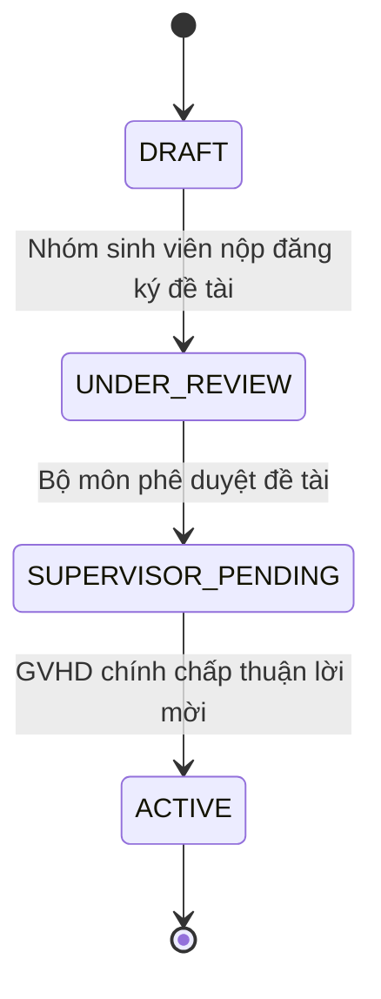

# Architectural & Technical Proposal: D18 Supervisor Workflow Policy

**Document Status**: PROPOSAL / PENDING ACADEMIC COUNCIL RATIFICATION  
**Technical Implementation Status**: COMPLETE & VERIFIED (Automated Tests PASS)  
**Date**: 2026-10-29  
**Authors**: Senior Backend Engineer, Solution Architect, QA Lead  
**Audience**: Khải (QA / Solution Lead), Academic Council, Department Chairs  
**Reference Pull Request**: `review/be-error-codes-and-audit` (PR #136) / `fix/complete-be07-staging-v5-partials`  

> [!IMPORTANT]
> **Cảnh báo tính chất văn bản**:  
> Đây là tài liệu **ĐỀ XUẤT KỸ THUẬT (Technical Proposal)** nhằm chuẩn hóa luồng nghiệp vụ và kiểm tra các cơ chế bảo vệ dữ liệu (guards/invariants) trong Backend.  
> Tài liệu này **CHƯA PHẢI là quy định hoặc chính sách học vụ chính thức của Nhà trường**.  
> Hệ thống Backend tôn trọng nguyên tắc fail-closed: Phần mềm sẵn sàng về mặt kỹ thuật, nhưng quyết định công nhận nghiệp vụ D18 hoàn toàn thuộc thẩm quyền của Hội đồng Học vụ và Ban Chủ nhiệm Khoa.

---

## 1. Executive Summary

Đề xuất kỹ thuật D18 xuất phát từ thực tế phối hợp giữa sinh viên và giảng viên:
- **Luồng SRS truyền thống (Canonical Post-Approval)**: Sinh viên chỉ được mời GVHD sau khi Bộ môn đã chính thức phê duyệt đề tài (`UNDER_REVIEW` -> `APPROVED` -> `SUPERVISOR_PENDING` -> GVHD Accept -> `ACTIVE`).
- **Thực tiễn học vụ đề xuất (D18 Pre-Approval Supervision)**: Nhóm sinh viên thường trao đổi, thống nhất định hướng nghiên cứu và xin ý kiến đồng ý từ GVHD ngay trong giai đoạn dự thảo đề tài (`DRAFT`).

Văn bản này trình bày phân tích kỹ thuật, cơ chế state machine song song và chứng cứ kiểm thử tự động nhằm đảm bảo việc cho phép GVHD Accept sớm **không phá vỡ tính toàn vẹn học vụ**.

---

## 2. Technical State Machine Specification

Hệ thống Backend hỗ trợ cả hai luồng nghiệp vụ trên cùng một nền tảng mà không gây xung đột dữ liệu:

### Path A: Canonical SRS Workflow (Hậu kiểm / Sau phê duyệt)

1. Đề tài được tạo ở trạng thái `DRAFT`.
2. Trưởng nhóm nộp đăng ký đề tài (`DRAFT` -> `UNDER_REVIEW`).
3. Cán bộ bộ môn thẩm định và phê duyệt (`UNDER_REVIEW` -> `SUPERVISOR_PENDING`).
4. Nhóm gửi lời mời GVHD; GVHD bấm **Chấp thuận** (`ACCEPT`).
5. Đề tài chuyển sang `ACTIVE`, tự động khởi tạo lịch milestone từ template đã ban hành.

---

### Path B: D18 Pre-Approval Supervision (Đề xuất Tiền kiểm / Đồng thuận sớm)

```mermaid
stateDiagram-v2
    [*] --> DRAFT
    DRAFT --> DRAFT: Mời GVHD & GVHD chấp thuận từ DRAFT
    note right of DRAFT: Giảng viên được cấp quyền đọc đề tài;\nĐề tài TUYỆT ĐỐI GIỮ NGUYÊN DRAFT;\nKHÔNG sinh milestone, KHÔNG nộp bài.
    DRAFT --> UNDER_REVIEW: Nhóm sinh viên nộp đề tài kèm GVHD đã xác nhận
    UNDER_REVIEW --> ACTIVE: Bộ môn chính thức phê duyệt
    note right of ACTIVE: Tự động kích hoạt nguyên tử;\nKhởi tạo milestones;\nGhi audit log và thông báo.
    ACTIVE --> [*]
```

1. Đề tài được tạo ở trạng thái `DRAFT`.
2. Trưởng nhóm gửi lời mời GVHD chính (và Mentor chuyên môn nếu là đề tài đa ngành) ngay từ `DRAFT`.
3. Giảng viên bấm **Chấp thuận** (`ACCEPT`):
   - Tạo bản ghi phân công với trạng thái `ACCEPTED`.
   - Giảng viên được cấp quyền đọc có phạm vi đối với thông tin đề tài và thành viên nhóm.
   - **Rào chắn cốt lõi**: Đề tài **TUYỆT ĐỐI KHÔNG chuyển `ACTIVE`**. Đề tài vẫn ở trạng thái `DRAFT`. Không có milestone hay cửa sổ nộp bài nào được mở.
4. Nhóm nộp đăng ký đề tài (`DRAFT` -> `UNDER_REVIEW`).
5. Cán bộ bộ môn phê duyệt đề tài:
   - Hệ thống kiểm tra thấy đã có GVHD chính xác nhận (`HasConfirmedPrimarySupervisor == true`).
   - Với đề tài đa ngành, kiểm tra đã đủ Mentor cho các ngành liên quan (`MissingMentorMajorIds.Count == 0`).
   - Đề tài tự động chuyển đổi nguyên tử: `APPROVED` -> `SUPERVISOR_PENDING` -> `ACTIVE`.
   - Sinh milestones, ghi nhận nhật ký kiểm toán (audit log) và gửi thông báo.

---

## 3. Strict Invariant Protections & Negative Guards

Tất cả các rào chắn kỹ thuật đã được hiện thực hóa ở tầng repository và giao dịch cơ sở dữ liệu, có kiểm thử tự động chứng thực:

| Rào chắn / Bất biến kỹ thuật | Cơ chế hiện thực | Kiểm thử tích hợp | Kết quả |
| :--- | :--- | :--- | :--- |
| **Không kích hoạt sớm** | `SupervisorRequestRepository.cs:144-151`: `shouldActivate = request.AssignmentType == "PRIMARY" && project.Status is "APPROVED" or "SUPERVISOR_PENDING";`. Nếu dự án đang `DRAFT`, `shouldActivate == false`. | `D18_1_send_and_accept_primary_on_draft_project_keeps_draft_and_grants_scoped_lecturer_read`, `D18_preapproval_supervision_blocks_execution_until_department_approval_then_activates` | **PASS** |
| **Rollback nguyên tử khi lỗi** | Toàn bộ quy trình kích hoạt dự án, phân công và sinh milestones nằm trong Transaction duy nhất. Lỗi audit hay milestone sẽ hoàn tác toàn bộ về `UNDER_REVIEW`. | `Preconfirmed_approval_activates_and_audit_failure_rolls_back_every_transition` | **PASS** |
| **Giới hạn số lượng hướng dẫn (Quota)** | Khóa dòng `UPDLOCK, HOLDLOCK` trên `supervisor_profiles`. Khi giảng viên đạt tối đa `MaxActiveProjects`, các lời mời tiếp theo trả về HTTP 409 Conflict. | `D18_6_reject_project_releases_accepted_requests_cancels_pending_and_frees_capacity` | **PASS** |
| **Xử lý tranh chấp đồng thời** | Giảng viên chấp thuận trước sẽ giành quyền. Các lời mời cạnh tranh còn lại cho cùng chuyên ngành sẽ tự động chuyển sang `CANCELLED`. | `D18_2_parallel_mentor_requests_for_same_major_first_accept_wins_and_cancels_loser` | **PASS** |
| **Hết hạn sau 7 ngày (168h)** | Lời mời quá 7 ngày tự động hết hạn khi đọc hoặc chấp thuận; không thể chấp thuận lời mời đã hết hạn. | `D18_7_pending_request_past_7_days_expires_on_read_and_accept` | **PASS** |
| **Ràng buộc Thỏa ước làm việc** | Nếu cấu hình `RequireWorkingAgreement` bật, giảng viên không thể chấp thuận cho đến khi tất cả thành viên trong nhóm đồng thuận (HTTP 422 `WORKING_AGREEMENT_INCOMPLETE`). | `Required_agreement_blocks_acceptance_then_activates_only_after_current_roster_consents` | **PASS** |
| **Thu hồi khi Bộ môn từ chối** | Nếu Bộ môn từ chối đề tài tại bước duyệt, các phân công GVHD đã nhận trước đó sẽ được giải phóng và hoàn trả quota cho giảng viên. | `D18_6_reject_project_releases_accepted_requests_cancels_pending_and_frees_capacity` | **PASS** |

---

## 4. Academic Decision Options for Council

Hội đồng Học vụ có thể lựa chọn 1 trong 2 phương án:

1. **Phương án 1 (Khuyến nghị)**: Chính thức phê chuẩn luồng D18 Pre-Approval Supervision bên cạnh luồng Canonical SRS. Cho phép sinh viên chủ động kết nối GVHD từ sớm nhằm nâng cao chất lượng đề tài trước khi nộp.
2. **Phương án 2 (Bảo lưu SRS thuần túy)**: Chỉ cho phép mời GVHD sau khi Bộ môn duyệt. Trong trường hợp này, Backend chỉ cần bật cờ chặn tính năng gửi lời mời từ DRAFT (qua `WorkflowContextActions`) mà không cần thay đổi cấu trúc bảng cơ sở dữ liệu.

**Kết luận kỹ thuật**: Backend đã sẵn sàng 100% cho cả hai kịch bản và bảo đảm an toàn dữ liệu tuyệt đối. Quyết định áp dụng thuộc về Hội đồng Học vụ.
