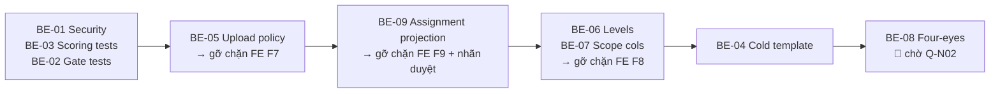

# 13 — BACKEND DEVELOPER TASKS: tiếp tục plan (BE-01 … BE-09)
**AI-PMS** · giao ngày **03/11/2026**
**Repository Path:** `ai-pms-backend` · nhánh gốc `develop` @ `01ec826`
**Đối tượng:** BE developer. Mục 4 dành cho FE developer.

> **Điểm khác mọi đợt trước:** FE **đã viết xong phía tiêu thụ** và đang chờ. Mục 3 là **hợp đồng tích hợp** — tên trường, đường dẫn, kiểu dữ liệu đều trích trực tiếp từ code FE trên nhánh `feat/fe-f1-f11-integrated-20261101`. Ship đúng tên đó thì FE chạy ngay, không sửa một dòng. Đặt tên khác là thêm một vòng lệch nữa.

---

## 1. Ngữ cảnh bắt buộc đọc

### 1.1 Tình trạng thật

| | SHA | Tình trạng |
|---|---|---|
| **BE `develop`** | `01ec826` | 🔴 **0/9 ticket** của plan được làm |
| **PR #140** | `7ba512d` | DRAFT, CI xanh, mergeable — **không chạm ticket nào** |
| **Nhánh FE** | `f82dd81` + sửa chưa commit | Xong hết phần làm được; phần còn lại **chờ BE** |

Việc BE đã làm từ 30/10: tính năng AI (`a572e76`) và PR #140 (chuẩn hóa mã lỗi + test). Chất lượng tốt — PR #140 có bằng chứng test cho từng khẳng định. Nhưng **không phải việc đã giao**.

🔴 **Lỗ hổng `BE-01` đã mở sang ngày thứ tư.** `ReviewGateService.cs:86` và `:138` vẫn chỉ gọi `RequireStaff`, nên staff bộ môn bất kỳ vẫn publish được lộ trình Review cho ngành của bộ môn khác.

### 1.2 ⚠️ Tài liệu đợt 30/10 đã mất

Thư mục `F:\AI-PMS\docs\` (ngoài hai repo, **không được git theo dõi**) bị xóa sạch trong đợt dọn ngày 01/11 — mất cả bộ 8 tài liệu bàn giao. Không còn bản sao nào trong workspace. Bản plan chủ và bản audit còn sống ở nơi khác, team leader giữ.

File này đặt **trong repo**, thư mục đã được git theo dõi. **Xin commit nó.**

### 1.3 Phần AI vừa ship — giữ nguyên, không đụng

BE `a572e76` thêm `ai_deliverable_review*` và progress risk. **Quyết định của team leader: giữ, không sửa, không refactor, không đổi cờ.** Hai cờ `AiAssistant:DeliverableReviewEnabled` / `ProgressRiskEnabled` mặc định `false` — giữ nguyên.

Để biết, không phải việc phải làm: `DeliverableReviewAnalyzer.cs:88` tính một số 0–100 từ chính tiêu chí của rubric chính thức. Nó không vào `StudentResult`, UI gọi là *"Mức độ đáp ứng nội dung"* — ổn. Chỉ đừng để nó cạnh điểm thật trên cùng màn hình.

### 1.4 Quy tắc làm việc

1. **Một task = một nhánh mới từ `develop` đã fetch = một PR.**
2. **Database First.** Không EF migrations. Schema đi qua `db/changes/<yyyyMMdd>_<tên>.sql` + `db/schema.sql` + **thêm dòng vào `db/e2e/migrations.json`**. Đợt AI vừa rồi làm đúng — giữ thói quen đó.
3. **Mọi exception phải có `errorCode`.** PR #140 vừa chuẩn hóa `ACADEMIC_SCOPE_UNKNOWN` — làm tiếp đúng kiểu đó.
4. Mọi thay đổi hành vi phải có test. CI `-warnaserror`.
5. **Nghiệm thu kèm lệnh chạy lại được**, không nhận bảng tự khai.

```bash
dotnet restore AIPMS.sln
dotnet build AIPMS.sln --configuration Release --no-restore -warnaserror
dotnet test AIPMS.sln --configuration Release --no-build
```

### 1.5 Mười bốn bất biến nghiệp vụ (BR)

| # | Quy tắc | Nguồn |
|---|---|---|
| **BR-N1** | **Hai bộ máy độc lập.** Review 1–2–3 chạy Review Gate (*đạt / phải sửa*). Review 4 chạy Evaluation (**điểm**). Không nối nhau | `ReviewGatesController` vs `PolicyEvaluationController` |
| **BR-N2** | **Trọng số tiến độ ≠ trọng số điểm.** Không cộng, không nhân vào nhau | `ReviewGateService.cs:589` vs `VersionedResultCalculator.cs:64` |
| **BR-N3** | **`Stage` và `Scope` là hai trục độc lập.** Một component = một ô (Stage × Scope × Major) | `SchemeComponentInput` |
| **BR-N4** | **Không nhân chồng hai hệ trọng số.** 30/70 theo chặng và 50/30/20 theo phạm vi giải vào từng ô, tổng 100 **đúng một lần** | v5 dòng 288 |
| **BR-N5** | **Chỉ chấm tiêu chí lá, ở effective weight.** Tiêu chí cha không có `MaxScore`, không `IsRequired` | `RubricRules.cs:25` |
| **BR-N6** | **`null` ≠ `0`.** Thiếu bất kỳ phiếu nào ⇒ kết quả `null`, **không chia lại trọng số** | `VersionedResultCalculator.cs:54` |
| **BR-N7** | **Demo ≠ chính thức.** `IsDemo=false` đòi `ApprovalStatus="APPROVED"` **và** `ApprovalReference` không rỗng | `VersionedResultCalculator.cs:17` |
| **BR-N8** | **Rubric đã publish và đã tham chiếu là bất biến.** Sửa = version mới | `RubricRules.cs:10` |
| **BR-N9** | **GVHD chính bị cấm chấm chính thức dự án mình hướng dẫn.** Mentor ngành KHÔNG bị cấm | `EvaluationDraftWorkflow.cs:114-117` |
| **BR-N10** | **Phiếu tuần là bằng chứng, không phải điểm.** `AffectsOfficialResult = false` | `WeeklyAssessmentService.cs:54` |
| **BR-N11** | **Số task / commit / contribution index KHÔNG quy thành điểm** | v5 dòng 199 |
| **BR-N12** | **Số mốc Review là cấu hình, không phải hằng số** | `ReviewGateContracts.cs:11-20` |
| **BR-N13** | **`Head of Department` là trách nhiệm học thuật, không phải role DB.** Không thêm identity role mới | `db/seed.sql` |
| **BR-N14** | **Annotation ≠ Official Correction.** Khác quyền, khác authority | BE hiện chỉ có `task_comments` |

**Bốn điều cấm:** phát triển thêm AI trong sản phẩm · điền `ApprovalReference` giả · sửa rubric đã publish · trả success khi chưa ghi thật.

### 1.6 🔧 ĐÍNH CHÍNH — hai ticket trước đây dán nhãn chặn, thực ra KHÔNG bị chặn

| Ticket | Bản 30/10 | Thực tế |
|---|---|---|
| `BE-06` mô tả mức | chờ `Q-A10` | ✅ **không chặn** — số mức là **cấu hình** `Rubric:RequiredLevelCount` (mặc định 4); bảng riêng chạy với N mức bất kỳ |
| `BE-07` cột scope | chờ `Q-N02` | ✅ **không chặn** — chỉ thêm **dữ liệu** mô tả phạm vi; phần *ai được làm gì* nằm ở `BE-08` |
| `BE-08` four-eyes | chờ `Q-N02` | 🔴 **chặn thật** — không thể đoán mô hình phân quyền |

⇒ **7/9 ticket làm được ngay.**

---

## 2. Thứ tự PR — xếp theo "cái gì gỡ chặn FE nhanh nhất"



Ba ticket nhóm A độc lập nhau, làm song song được. **`BE-09` đứng sớm vì nó rẻ nhất trong nhóm gỡ chặn** (chỉ thêm projection, không schema) nhưng mở khóa **hai** thứ FE đang hiển thị trống.

---

## 3. Đặc tả từng ticket

### BE-01 — Siết authority template Review Gate 🔴 SECURITY
- Objective: Chặn staff bộ môn tạo/công bố lộ trình Review cho ngành hoặc kỳ không thuộc phạm vi mình.
- DoD: Staff MKT gọi SaveTemplate với Major="SE" ⇒ 403 kèm TEMPLATE_SCOPE_FORBIDDEN; với Major="MKT" + kỳ của mình ⇒ 200; ADMIN trần publish ⇒ 403; chín call site còn lại không đổi hành vi; test mới xanh.

### BE-02 — Hai mươi test hành vi Review Gate
- Objective: Dựng lưới an toàn trước khi ai đó sửa Gate.Status (19 call site).
- DoD: dotnet test --filter "FullyQualifiedName~ReviewGateServiceBehaviorTests" ⇒ Passed: 20, Failed: 0; git diff --stat origin/develop...HEAD -- src/ ⇒ rỗng; mô tả PR liệt kê mọi chỗ gắn TODO(GATE-02).

### BE-03 — Mười hai test tính điểm 11 component 🔴 CRITICAL
- Objective: Chứng minh bộ máy tính điểm đúng với cấu trúc 11 component trước khi chấm điểm thật.
- DoD: Passed: 12, Failed: 0; không sửa file nào trong src/; ca FinalizedEvaluators chứng minh rõ không có chỗ nào chia lại trọng số.

### BE-04 — Cold template cho phạm vi CHUNG
- Objective: Cho phép dự án liên ngành tạo bộ báo cáo chấm nguội phần CHUNG (không thuộc ngành nào).
- DoD: Bốn ca đúng; template cũ (scope = NULL, có major_id) GET trả về bình thường; migration chạy hai lần không lỗi.

### BE-05 — Upload policy endpoint
- Objective: Expose giới hạn và loại tệp cho phép để FE đọc thay vì đoán.
- DoD: Endpoint trả đủ 11 entry, maxBytes khớp giới hạn hiệu lực; sửa hằng ⇒ cả [RequestSizeLimit] và response đổi theo, có test chứng minh hai chỗ không lệch; example JSON đã nằm trong docs/contracts/.

### BE-06 — rubric_criterion_levels + hai cột hướng dẫn
- Objective: Rubric lưu được mô tả mức chất lượng, để hai giảng viên chấm cùng bài không lệch nhau.
- DoD: Migration chạy hai lần không lỗi; lưu nháp khi chưa có mức ⇒ 200; thiếu 1 mức ⇒ gửi duyệt 422 kèm tên tiêu chí; mức trên tiêu chí cha ⇒ 422; rubric legacy đọc/chấm/publish bình thường; đổi RequiredLevelCount 4→5 ⇒ validate theo 5 không cần build lại DB; RubricHierarchyMigrationTests và smoke test WeeklyAssessment vẫn xanh.

### BE-07 — Bảy cột scope trên rubrics
- Objective: Phân biệt được 9 rubric của một kỳ liên ngành bằng dữ liệu, không bằng code tự nhập.
- DoD: Tạo được 9 rubric cùng department + semester phân biệt bằng bốn trường; bốn ca 422 đúng; UpdateRubricRequest có approvalReference ⇒ bị bỏ qua, DB không đổi; rubric legacy (7 cột NULL) đọc/chấm/publish bình thường; rubric PUBLISHED + referenced sửa 7 cột ⇒ 409.

### BE-08 — PENDING_APPROVAL + four-eyes 🔴 chờ Q-N02
- Objective: Không để một người vừa soạn vừa công bố rubric dùng chấm điểm thật.
- DoD: Người gửi tự duyệt ⇒ 403; người khác cùng phạm vi ⇒ 200 + có hàng rubric_approvals với decided_by ≠ submitted_by; staff bộ môn tham gia duyệt rubric COMMON liên ngành ⇒ 403; ADMIN trần ⇒ 403; reject không lý do ⇒ 422; approve không approvalReference ⇒ 200 nhưng scheme dùng rubric đó không publish được ở IsDemo=false; rubric legacy publish trực tiếp vẫn 200.

### BE-09 — Projection lên assignment detail + ParentId
- Objective: Người chấm thấy đúng trạng thái phê duyệt, tỷ trọng phiếu, và cây tiêu chí.
- DoD: GET /evaluation-assignments/{id} trả đủ 5 trường mới + parentId trên từng score; rubric legacy ⇒ các trường mới null/[], chấm và chốt bình thường; phiếu legacy stage = null không bị backfill thành "DEFENSE"; example JSON hai biến thể (có dữ liệu mới / legacy) trong docs/contracts/.
